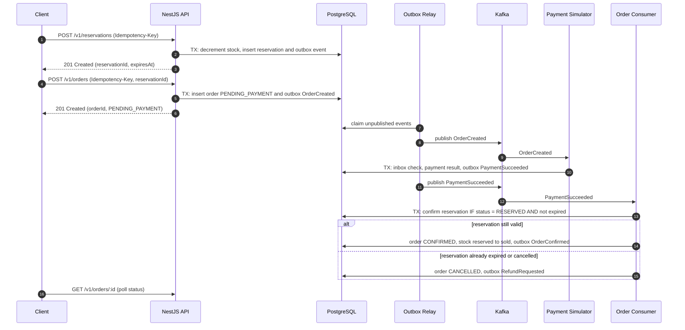

# HIGH-CONCURRENCY INVENTORY & RESERVATION PLATFORM

**A-to-Z Project Specification, Architecture, Engineering Principles & Interview Guide**

*Based on the reference document: High_Concurrency_Inventory_Reservation_Project_Specification.docx*

*Revision 2 (2026-10-10): added software design, domain modeling, API design, resilience, SLO, testing and engineering-workflow guidance, and corrected internal inconsistencies. See Appendix A for a summary.*

**Recommended implementation:** NestJS + TypeScript, with a modular application and separately runnable background workers  
**Portfolio objective:** demonstrate production-oriented backend engineering, concurrency, database depth, distributed systems, reliability, scalability, and observability.

| Item | Decision |
| :--- | :--- |
| Primary goal | Build one standout engineering project for Software Engineer / Backend / Full-Stack applications |
| Recommended language | TypeScript on Node.js |
| Backend framework | NestJS |
| Primary database | PostgreSQL |
| Cache / coordination | Redis |
| Event streaming | Apache Kafka |
| Service communication | REST / JSON for the initial version; internal messaging through Kafka where asynchronous processing is appropriate |
| Testing | Jest, Supertest, Testcontainers, fast-check (property-based) |
| Load testing | k6 |
| Observability | OpenTelemetry, Prometheus, Grafana, Jaeger, Pino structured logs |
| Code quality | Strict TypeScript, ESLint, Prettier; module boundaries checked in CI |
| Containerization | Docker / Docker Compose |
| Cloud / IaC | AWS; Terraform optional for repeatable infrastructure |
| API documentation | Swagger / OpenAPI generated from Zod schemas |
| CI/CD | GitHub Actions |
| Target build time | ~6 weeks for the core scope (+1–2 optional weeks for stretch goals) |
| Local development cost | Can be kept at $0 by running the stack locally |

---

## Contents
1. Executive Overview
2. What Problem Does This Project Solve?
3. What the System Is Supposed to Do
4. Why This Project Is High-Impact for a Resume
5. Scope and Non-Goals
6. High-Level Architecture
7. Recommended Technology Stack
8. Core Modules and Background Workers
9. Software Design Principles and Code Architecture
10. Functional and Non-Functional Requirements
11. Domain Model and State Machines
12. API Design
13. Database Design
14. Concurrency Control
15. Transaction and Consistency Strategy
16. Redis Caching Strategy
17. Kafka and Event-Driven Architecture
18. Idempotency
19. Transactional Outbox Pattern
20. Reservation Expiry and Recovery
21. Checkout Workflow as a Saga
22. Retries, Dead-Letter Handling and Failure Recovery
23. Rate Limiting, Backpressure and Abuse Prevention
24. Resilience and Process Lifecycle
25. Connection Pools and Resource Management
26. Observability
27. SLOs, Alerting and Runbooks
28. Load Testing and Benchmarking
29. Failure Injection / Chaos Testing
30. Security
31. Testing Strategy
32. Repository / Folder Structure
33. Local Development Environment
34. Engineering Workflow and Documentation
35. AWS and Terraform Architecture
36. CI/CD
37. Six-Week Implementation Roadmap
38. Definition of Done
39. What to Put in the GitHub README
40. Resume Entry
41. Interview Topics and Questions
42. What This Project Proves About You
43. Stretch Goals (Stand-Out Extensions)
44. What NOT to Over-Engineer
45. Final Recommended Stack

Appendix A. Revision Summary

---

## 1. Executive Overview
The High-Concurrency Inventory & Reservation Platform is a backend-heavy distributed system designed to model a difficult real-world problem: many customers competing for a limited quantity of inventory at the same time. The portfolio value comes from the engineering constraints rather than from a large UI.

The system should behave correctly when hundreds or thousands of purchase or reservation requests arrive concurrently. It must prevent overselling, avoid duplicate orders during retries, recover from partial failures, process work asynchronously, and remain observable and measurable under load.

This project is intentionally different from a normal CRUD application. Its main purpose is to demonstrate that you can reason about correctness, performance, consistency, failure modes, and trade-offs.

*   **Primary scenario:** flash-sale / limited-inventory reservation and checkout.
*   **Primary engineering question:** how do we keep inventory correct while many requests compete for the same scarce resource?
*   **Secondary engineering questions:** how do we cache safely, publish events reliably, survive worker/API failures, and prove the system scales?

## 2. What Problem Does This Project Solve?
Imagine a product has only 100 units available. At the moment a sale starts, thousands of users attempt to buy it. A naive application can read the same stock value in many requests, decrement it independently, and accidentally oversell.

*   Request A reads stock = 1
*   Request B reads stock = 1
*   Request A writes stock = 0
*   Request B writes stock = 0
*   **Result:** two orders may exist for one physical unit.

The project solves this class of problem by making inventory a protected resource and explicitly designing the system around database transactions, concurrency control, idempotency, caching, asynchronous events, retries, and failure recovery.

**The business-style problem in one sentence:**  
Safely reserve and sell scarce inventory under high concurrent traffic without overselling, duplicating orders, or losing important events.

## 3. What the System Is Supposed to Do
The platform provides a small commerce/reservation flow with enough complexity to expose production-grade engineering challenges.

| Flow | Expected behavior |
| :--- | :--- |
| Browse products | Return product information quickly, preferably from cache after the first request. |
| Check availability | Return current availability while making the source of truth clear. |
| Create reservation | Atomically reserve inventory if sufficient quantity exists. |
| Create order | Create one logical order even if the client retries. |
| Process payment | Model an asynchronous payment workflow and explicit success/failure states. |
| Confirm order | Transition reservation/order states safely and emit events. |
| Expire reservation | Automatically release stock when a reservation passes its expiry time. |
| Notify customer | Process notifications asynchronously and recover from temporary failures. |
| Reconcile inventory | Periodically prove that inventory counters match reservation and order records. |
| Observe system | Expose logs, metrics, traces and operational dashboards. |

## 4. Why This Project Is High-Impact for a Resume
Your existing resume already demonstrates TypeScript/NestJS, PostgreSQL, AWS, microservices, message-driven communication, Kafka-related work, and AI/RAG systems. This project should therefore add a different kind of evidence: deep systems engineering.

| Current profile evidence | New project should add |
| :--- | :--- |
| NestJS / Node / TypeScript backend | Deeper database and concurrency engineering rather than another language switch |
| Microservices / REST | Transactional correctness, idempotency, reliable event publication, and measured performance |
| PostgreSQL usage | Indexes, EXPLAIN ANALYZE, isolation, row locks, pooling |
| Messaging / Kafka | Reliable event publication, retries, idempotent consumers, DLQ |
| AWS | Local-first architecture first; production-style AWS deployment later |
| Feature delivery | Benchmark-driven performance and reliability engineering |
| Code that works | Code that is visibly designed: enforced module boundaries, explicit state machines, tested invariants, documented decisions |

The strongest resume signal is not the number of services. It is the fact that you can demonstrate an engineering problem, reproduce it under load, explain the chosen solution, and show measurements before and after the optimization.

## 5. Scope and Non-Goals

**In scope**
*   Product catalog and inventory
*   Reservations and order lifecycle
*   Concurrency control
*   Transactions and isolation
*   PostgreSQL indexing and query optimization
*   Redis caching and rate limiting
*   Kafka event workflows
*   Idempotency
*   Transactional outbox
*   Retries and dead-letter processing
*   Reservation expiry
*   Load testing
*   Observability
*   Failure injection
*   Docker local environment
*   Optional AWS/Terraform deployment
*   CI/CD
*   Code architecture and enforced module boundaries
*   Explicit domain state machines and the checkout saga
*   API design conventions (versioning, errors, pagination)
*   Resilience: timeouts, circuit breakers, health checks, graceful shutdown
*   SLOs, alerting and runbooks
*   Security baseline and abuse prevention
*   Engineering documentation (ADRs, C4 and sequence diagrams)

**Out of scope**
*   A polished consumer-grade storefront
*   Real financial payment processing with real money
*   Complex recommendation systems
*   Full warehouse management
*   Multi-region active-active deployment
*   A massive Kubernetes platform from day one

The project is a portfolio engineering system, not a production business that must be launched to real customers.

## 6. High-Level Architecture

**Recommended starting architecture: a modular NestJS application plus separately runnable background workers.** This keeps the initial build achievable while still letting you demonstrate production-style boundaries, concurrency control, reliable asynchronous processing, and operational behavior. Do not create several independently deployed microservices before the core inventory workflow works correctly.

```text
                         Next.js Client
                              |
                         REST / JSON
                              |
                    +---------v----------+
                    |    NestJS API      |
                    |  Modular Monolith  |
                    | stateless replicas |
                    +---------+----------+
                              |
            +-----------------+------------------+
            |                 |                  |
     +------v------+   +------v-------+   +------v-------+
     | Product     |   | Inventory &  |   | Orders &     |
     | Catalog     |   | Reservations |   | Idempotency  |
     +-------------+   +------+-------+   +------+-------+
                              |                  |
                              +---------+--------+
                                        |
                             +----------v-----------+
                             |     PostgreSQL       |
                             | Source of truth       |
                             | business data + outbox|
                             +----------+------------+
                                        |
                       +----------------+----------------+
                       |                                 |
                +------v------+                   +------v------+
                |    Redis    |                   | Outbox Relay |
                | Cache /     |                   | publishes   |
                | Rate Limit  |                   | committed   |
                +-------------+                   | events      |
                                                  +------+------+
                                                         |
                                                   +-----v-----+
                                                   |   Kafka   |
                                                   +-----+-----+
                                                         |
                                +------------------------+------------------+
                                |                        |                  |
                         +------v-------+        +-------v------+   +-------v--------+
                         | Payment      |        | Notification |   | Other event    |
                         | Simulator    |        | Worker       |   | consumers      |
                         +--------------+        +--------------+   +----------------+

     Reservation-expiry worker: scans/claims expired reservations and releases stock safely.

     Telemetry: OpenTelemetry -> Prometheus (metrics) / Jaeger (traces) -> Grafana dashboards
```

### Architecture rules

1. **PostgreSQL is authoritative** for inventory quantities, reservations, orders, idempotency records, and outbox events. Redis must never be the source of truth for inventory writes.
2. **Keep business modules separate in code** even if they initially run in one API process. Define module boundaries around responsibilities and business rules.
3. **Run background work in separate processes when useful.** The outbox relay, reservation-expiry job, payment simulator, and notification consumer can reuse the same repository and shared domain code without becoming separate microservices immediately.
4. **Use Kafka for asynchronous work**, not for every internal function call. Keep operations that need an immediate, consistent response on the synchronous API/database path.
5. **Extract a module into a separately deployed service only when there is a clear reason**, such as independent scaling, ownership, failure isolation, or a useful architecture experiment. Service extraction is an optional later milestone.
6. **Keep the initial local environment simple.** Docker Compose can run PostgreSQL, Redis, Kafka, Prometheus, Grafana, and Jaeger. Run the NestJS API and workers locally during early development if that makes iteration easier.
7. **Every process is stateless and safe to run as multiple instances.** No correctness-relevant state lives in process memory; concurrency guarantees come from PostgreSQL, so adding API or worker instances never breaks correctness.

## 7. Recommended Technology Stack

| Layer | Recommended technology | Why it is used |
| :--- | :--- | :--- |
| Language / runtime | TypeScript + Node.js | Reuses your existing backend strengths so effort can go into database correctness, concurrency, reliability, and performance experiments. |
| Backend framework | NestJS | Modular structure, dependency injection, guards/interceptors, validation integration, testing support, and Kafka transport support. |
| Frontend | Next.js | A small demonstration UI for products, reservations, orders, and an engineering metrics view. Keep it intentionally simple. |
| External API | REST / JSON | Straightforward client integration, HTTP semantics, and easy API testing. |
| Request validation | Zod | Schema-based input validation and inferred TypeScript types. Use consistent schemas at request boundaries. |
| API documentation | Swagger / OpenAPI | Document endpoint contracts and make the API easy to inspect and test. Generate it from the Zod schemas (Section 12). |
| Database | PostgreSQL | Transactions, constraints, row-level locking, isolation, indexes, query plans, and relational consistency. |
| Data access | Prisma + parameterized SQL | Use Prisma for ordinary type-safe data access and migrations; use carefully parameterized SQL for critical locking/atomic-update flows and query-plan experiments. |
| Cache / rate limiting | Redis | Cache-aside for product reads, rate limiting, and selected ephemeral coordination. PostgreSQL remains authoritative for inventory and durable idempotency guarantees. |
| Messaging | Apache Kafka | Asynchronous events, consumer groups, retry/recovery patterns, event ordering considerations, and lag monitoring. |
| Unit / API tests | Jest + Supertest | Unit testing and HTTP integration tests for NestJS endpoints. |
| Dependency-backed integration tests | Testcontainers | Start real PostgreSQL, Redis, and Kafka containers for tests that need realistic dependency behavior. |
| Property-based testing | fast-check | Generates random operation sequences to prove inventory invariants hold, not just hand-picked examples. |
| Load testing | k6 | Controlled concurrent traffic, latency/error measurements, and reproducible benchmark scenarios. |
| Telemetry instrumentation | OpenTelemetry | Request traces, spans, and metrics instrumentation. |
| Metrics / dashboards | Prometheus + Grafana | Store/query metrics and visualize latency, errors, pool pressure, cache hit rate, and consumer lag. |
| Trace UI | Jaeger | Inspect distributed traces and follow a request across the API, database-facing spans, and asynchronous workflows where propagation is configured. |
| Logging | Pino structured JSON logs | Machine-readable logs with request/correlation IDs and useful diagnostic fields. |
| Code quality | ESLint + Prettier + Husky / lint-staged | Consistent style and early feedback before code reaches CI. |
| Architecture rules | dependency-cruiser | Enforces module boundaries and layering rules automatically in CI. |
| Containerization | Docker + Docker Compose | Reproducible local dependencies and service execution. |
| Cloud | AWS (optional later stage) | Demonstrates deployment and operations once the local application is correct and measured. |
| Infrastructure as Code | Terraform (optional) | Repeatable cloud provisioning if you actually deploy the project. |
| CI/CD | GitHub Actions | Automated lint, type-check, test, build, and optional deployment workflows. |

### Tool-selection rules

- Do not add a technology just to increase the count on the resume. Use each tool to solve a concrete problem and document the trade-off.
- Start without gRPC, Kubernetes, Elasticsearch/OpenSearch, GraphQL, or a separate API gateway. They are not required to prove the core engineering goals.
- Do not add Redis distributed locks to the initial version. Protect inventory invariants with PostgreSQL transactions/atomic updates first.
- Use Testcontainers for dependency-backed integration tests; mocks alone cannot prove PostgreSQL locking or transaction behavior.
- Keep AWS and Terraform optional until the core flow, tests, observability, and benchmarks work locally. A cloud deployment is not required to demonstrate the correctness of the reservation algorithm.

## 8. Core Modules and Background Workers

Start with one NestJS codebase split into clear modules. The API and selected workers can run as different processes using the same repository. This keeps the first implementation manageable without sacrificing clear boundaries.

| Module / worker | Responsibilities |
| :--- | :--- |
| Product Catalog module | Product metadata, list/detail endpoints, query access patterns, and cache-aside reads. |
| Inventory & Reservation module | Inventory source of truth, reservation lifecycle, stock decrement/release, locking and concurrency invariants. |
| Orders & Idempotency module | Order creation, order state transitions, request deduplication, and order history. |
| Identity & Access module | Users, authentication (JWT or external IdP), roles (user/admin), ownership checks. |
| Payment simulator | Simulated success/failure/timeout outcomes; no real financial processing. Initially a Kafka consumer or background worker. |
| Outbox relay | Claims unpublished outbox rows, publishes events to Kafka, and safely records publication progress. |
| Reservation-expiry worker | Claims expired reservations and releases stock without double-processing. |
| Reconciliation job | Periodically verifies inventory counters against reservation/order records and alerts on any mismatch. |
| Notification consumer | Simulated notification delivery, retries, and dead-letter handling. |
| Observability layer | Request IDs, Pino logs, OpenTelemetry traces/metrics, Prometheus/Grafana dashboards, Jaeger trace UI. |

You may keep Product, Inventory, and Orders in one API application initially. Extracting a module into a separate microservice is an optional later exercise, not an early requirement.

## 9. Software Design Principles and Code Architecture

The rest of this specification describes how the *system* behaves. Reviewers and interviewers will also open the *code*. It should show that you can structure a non-trivial codebase so that business rules are easy to find, test and change, and that the design principles you talk about are visible in the repository.

### Layered structure inside each module
A pragmatic hexagonal (ports and adapters) layout, without full DDD ceremony:

```text
apps/api/src/modules/inventory/
├── domain/           # Entities, value objects, state machines, domain errors.
│                     # Pure TypeScript: no NestJS, Prisma, Kafka or Redis imports.
├── application/      # Use cases (ReserveStock, CancelReservation), ports (interfaces),
│                     # transaction boundaries.
├── infrastructure/   # Prisma/SQL repositories, outbox writer, Redis adapters (implement ports).
└── interface/        # HTTP controllers, Zod request/response schemas, Kafka handlers.
```

**Dependency rule:** `interface → application → domain`, and `infrastructure` implements ports defined in `application`. The `domain` layer depends on nothing, which makes the most important business rules testable in milliseconds without a database.

### Principles that should be visible in the code

| Principle | Where it shows up in this project |
| :--- | :--- |
| Single Responsibility | One use-case class per command (`ReserveStockHandler`, `ExpireReservationsHandler`) instead of one large `InventoryService`. |
| Open/Closed + Strategy pattern | A `ReservationStrategy` interface with pessimistic, optimistic and atomic-update implementations; the benchmark switches them via configuration without changing callers. |
| Dependency Inversion | Use cases depend on ports (`InventoryRepository`, `EventPublisher`, `Clock`, `PaymentGateway`); NestJS DI binds the infrastructure implementations. |
| Interface Segregation | Small, role-specific ports (e.g., `OutboxWriter` for use cases, `OutboxReader` for the relay). |
| Explicit invariants / fail fast | Domain methods reject illegal quantities and state transitions before any I/O; database constraints are the last line of defense. |
| Make illegal states unrepresentable | String-literal and discriminated unions for states; exhaustive `switch` with a `never` check so a new state forces compile errors where it is not handled. |
| Composition over inheritance | Share behavior through injected collaborators, not deep base-class hierarchies. |
| DRY without coupling | Share contracts (`packages/contracts`) between apps; do not share internal domain types between modules. |
| Determinism | Inject a `Clock` and ID generator so expiry and ordering logic are deterministic in tests. |

### Design patterns used (and why)

| Pattern | Used for |
| :--- | :--- |
| Repository + Unit of Work | Data access behind ports; one transaction per use case, passed explicitly (or via `AsyncLocalStorage`) to repositories. |
| Strategy | Swappable concurrency-control strategies (Section 14). |
| State machine | Reservation, order and payment lifecycles (Section 11). |
| Transactional Outbox / Inbox | Reliable publication and idempotent consumption (Sections 18–19). |
| Saga with compensation | Checkout workflow spanning the asynchronous payment step (Section 21). |
| Cache-aside | Product reads (Section 16). |
| Circuit Breaker, Timeout, Retry with backoff | Calls to Redis, Kafka and the payment simulator (Sections 22 and 24). |

### Module boundary rules
- A module exposes a small public API: an exported application service/facade and its events. Other modules never import its repositories or entities and never query its tables directly.
- Enforce the rules in CI with `dependency-cruiser` (or `eslint-plugin-boundaries`). Example rules: `domain` may not import `@nestjs/*` or `@prisma/client`; `orders` may not import `inventory/infrastructure`. An *enforced* modular monolith is a strong and uncommon signal; an unenforced one tends to decay into a big ball of mud.
- Where one business transaction must touch two modules' tables (for example, confirming a reservation while confirming an order), make it explicit in a single application-layer use case and record it in an ADR. That seam is exactly what would become a saga if the module were extracted into its own service, which makes it a good interview discussion.

### Error handling
- Typed domain errors (`InsufficientStockError`, `ReservationExpiredError`, `InvalidStateTransitionError`, `IdempotencyKeyReusedError`) are mapped to HTTP responses in one global exception filter (Section 12). No thrown strings, no leaked stack traces or SQL errors.
- Expected business outcomes (out of stock) are not incidents: log them at `info` and count them with a metric. Unexpected failures (database unavailable) log at `error` and drive alerts.
- Every error is classified as retryable or non-retryable; database retry logic, Kafka consumers and the DLQ all use the same classification.

### Code-quality baseline
- TypeScript `strict: true` plus `noUncheckedIndexedAccess`; no `any` in domain or application code.
- ESLint (typescript-eslint with type-checked rules) and Prettier; Husky + lint-staged run them before each commit, and CI enforces them.
- Conventional Commits; small, reviewable changes.
- Meaningful names, small functions, and comments that explain *why*, not *what*.
- Pragmatism: introduce a port only at a real boundary (database, broker, cache, clock, payment provider). Interfaces with a single trivial implementation everywhere add ceremony without value (Section 44).

## 10. Functional and Non-Functional Requirements

### Functional requirements
*   **Products:** Create/list/get products with price and inventory metadata.
*   **Inventory:** Query availability and maintain available/reserved/sold quantities.
*   **Reservations:** Create, confirm, cancel and expire reservations.
*   **Orders:** Create an order from a valid reservation; expose current status and history.
*   **Payments:** Simulate asynchronous payment success, failure, timeout and retry.
*   **Events:** Publish domain events for state transitions.
*   **Notifications:** Send simulated confirmation/failure notifications asynchronously.
*   **Identity:** Authenticate users; distinguish user and admin roles; users can only see their own reservations and orders.
*   **Limits:** Enforce a maximum quantity per reservation and a maximum number of active reservations per user.
*   **Reconciliation:** Periodically verify inventory counters against reservation and order records.
*   **Admin operations:** Optional endpoints for stock adjustment and event replay/reconciliation.

### Non-functional requirements
Functional requirements say what the system does; non-functional requirements say how well it must do it. Targets below are starting points; replace them with values justified by your measurements.

| Quality attribute | Requirement |
| :--- | :--- |
| Correctness | Zero oversells and zero duplicate orders in every test, load and chaos run. |
| Performance | Reservation latency target (e.g., P95 < 200 ms at normal load), formalized as SLOs in Section 27. |
| Scalability | The API is stateless and runs as N instances; throughput increases with instances until a documented bottleneck (e.g., a hot inventory row or the database). |
| Availability / resilience | Redis or Kafka failure does not stop reservations; database failure fails fast with `503` instead of hanging. |
| Durability | No committed business event is lost (outbox); no failed message is silently dropped (DLQ). |
| Observability | Any request can be followed end to end by request ID / trace ID. |
| Security | Authenticated writes, owner-only reads, audited admin actions, no secrets in Git. |
| Maintainability | Module boundaries enforced in CI; domain logic unit-testable without infrastructure. |
| Reproducibility | One-command local setup; every benchmark reproducible from scripts in the repository. |

## 11. Domain Model and State Machines

Every status column has a defined set of legal transitions. Anything else is rejected and treated as a bug. Explicit state machines are where most concurrency bugs in this system will be prevented or caught.

### Reservation

| From | Trigger | To | Inventory effect | Event |
| :--- | :--- | :--- | :--- | :--- |
| — | Reserve (enough stock) | `RESERVED` | available −q, reserved +q | `ReservationCreated` |
| `RESERVED` | Payment confirmed before `expires_at` | `CONFIRMED` | reserved −q, sold +q | `ReservationConfirmed` |
| `RESERVED` | User cancels | `CANCELLED` | reserved −q, available +q | `ReservationReleased` |
| `RESERVED` | `expires_at` passed (expiry worker) | `EXPIRED` | reserved −q, available +q | `ReservationExpired` |
| `CONFIRMED` / `CANCELLED` / `EXPIRED` | Anything | Rejected | — | — (terminal states) |

### Order

| From | Trigger | To |
| :--- | :--- | :--- |
| — | Create order from a `RESERVED` reservation | `PENDING_PAYMENT` |
| `PENDING_PAYMENT` | Payment succeeded and reservation confirmed | `CONFIRMED` |
| `PENDING_PAYMENT` | Final payment failure, reservation expired, or user cancels | `CANCELLED` |
| `PENDING_PAYMENT` | Payment succeeded but the reservation had already expired | `CANCELLED` + `RefundRequested` (Section 21) |
| `CONFIRMED` / `CANCELLED` | Anything | Rejected (terminal states) |

### Payment

| From | Trigger | To |
| :--- | :--- | :--- |
| — | Payment attempt started | `PENDING` |
| `PENDING` | Provider reports success | `SUCCEEDED` |
| `PENDING` | Provider reports a definitive failure | `FAILED` |
| `PENDING` | Timeout / unknown outcome | Stays `PENDING`; query status or retry with the same provider idempotency key |
| `SUCCEEDED` | Order cannot be confirmed (reservation expired) | `REFUNDED` (simulated) |

### Implementation rules
1. **One place decides legality.** A pure `transition(current, event)` function or entity method; illegal transitions throw `InvalidStateTransitionError`.
2. **Persist transitions as compare-and-set.** `UPDATE reservations SET status = 'CONFIRMED' WHERE id = $1 AND status = 'RESERVED' AND expires_at > now()`. Zero rows updated means another actor won the race; reload and decide. This makes races between the expiry worker and payment confirmation safe without application-level locks.
3. **Every transition writes history** (`order_status_history` / `audit_logs`) and, where relevant, an outbox event in the same transaction.
4. **Unit-test the full transition table**, including every illegal transition (table-driven tests).

### Money, time and quantities
- Store money as integer minor units (`price_cents BIGINT`) or `NUMERIC`, never JavaScript floating point, and store the currency code. Snapshot `unit_price` into `order_items` at order time so later price changes never rewrite history.
- Store all timestamps as `timestamptz` in UTC. Use the database clock (`now()`) for expiry comparisons so multiple workers never disagree because of clock skew.
- Quantities are positive integers, validated in the domain and constrained in the database.

### Single-item vs multi-item reservations
Start with single-product reservations: this is enough for the flash-sale story. Multi-item carts (a `reservation_items` table, all-or-nothing reservation across several inventory rows) are a strong stretch goal because they introduce deadlock risk and require deterministic lock ordering (Section 14).

## 12. API Design

### Endpoints (v1)

| Method | Path | Purpose | Notes |
| :--- | :--- | :--- | :--- |
| `POST` | `/v1/auth/login` | Obtain an access token | Only if not using an external IdP |
| `GET` | `/v1/products` | List products | Keyset pagination; cached |
| `GET` | `/v1/products/:id` | Product detail | Cache-aside |
| `GET` | `/v1/products/:id/availability` | Current availability | Informational; the reservation call is authoritative |
| `POST` | `/v1/reservations` | Reserve stock | `Idempotency-Key` required; `201`, or `409` for insufficient stock |
| `GET` | `/v1/reservations/:id` | Reservation status | Owner only |
| `POST` | `/v1/reservations/:id/cancel` | Cancel a reservation | Owner only; idempotent |
| `POST` | `/v1/orders` | Create an order from a reservation | `Idempotency-Key` required; `201` with status `PENDING_PAYMENT` |
| `GET` | `/v1/orders/:id` | Order status and history | Owner only |
| `GET` | `/v1/orders` | Current user's orders | Keyset pagination |
| `POST` | `/v1/admin/inventory/:productId/adjustments` | Restock / correct stock | Admin only; audited |
| `GET` | `/health/live`, `/health/ready` | Liveness / readiness | Section 24 |
| `GET` | `/metrics` | Prometheus scrape | Not publicly exposed |

### Status-code semantics

| Status | When |
| :--- | :--- |
| `200 OK` / `201 Created` | Success / resource created (with a `Location` header) |
| `400 Bad Request` | Malformed request, failed validation, missing `Idempotency-Key` |
| `401` / `403` | Not authenticated / authenticated but not allowed |
| `404 Not Found` | Resource does not exist; also returned for resources owned by another user, so their existence is not leaked |
| `409 Conflict` | Insufficient stock, illegal state transition, idempotent request still in progress |
| `422 Unprocessable Content` | `Idempotency-Key` reused with a different payload |
| `429 Too Many Requests` | Rate limited; includes `Retry-After` |
| `503 Service Unavailable` | Load shedding or a required dependency is down; includes `Retry-After` |

### Error format
Use one format for every error: RFC 9457 Problem Details, extended with a stable machine-readable `code` and the `traceId` for debugging.

```json
{
  "type": "/problems/insufficient-stock",
  "title": "Insufficient stock",
  "status": 409,
  "detail": "Requested 3 units of SKU-123; 1 available.",
  "instance": "/v1/reservations",
  "code": "INSUFFICIENT_STOCK",
  "traceId": "4bf92f3577b34da6a3ce929d0e0e4736"
}
```

### Conventions
- URI versioning (`/v1`): additive changes keep the version; breaking changes create `/v2`.
- Keyset (cursor) pagination: `?limit=50&cursor=<opaque>`. It stays stable under concurrent inserts and is efficient on large tables, unlike `OFFSET`; compare both with `EXPLAIN ANALYZE` (Section 13).
- Validate at the edge with strict Zod schemas. Rejecting unknown fields also prevents mass assignment. Set request body size limits.
- Accept and return `X-Request-Id`; include it in logs and error responses.
- Generate the OpenAPI document from the same Zod schemas (e.g., `nestjs-zod` or `@asteasolutions/zod-to-openapi`) so validation and documentation cannot drift. Document error responses and examples, not just the happy path.
- Asynchronous work returns immediately with a status the client can poll (`GET /v1/orders/:id`).
- Time values in ISO-8601 UTC; money as integer minor units plus a currency code.

## 13. Database Design
PostgreSQL is the source of truth for inventory and transactional business state. Redis is not the authoritative inventory database.

| Table | Important columns / purpose |
| :--- | :--- |
| `users` | id, email, password_hash (if local auth), role, created_at |
| `products` | id, sku (unique), name, price_cents, currency, status, created_at, updated_at |
| `inventory` | product_id, total_quantity, available_quantity, reserved_quantity, sold_quantity, version, updated_at |
| `reservations` | id, user_id, product_id, quantity, status, expires_at, created_at, updated_at |
| `orders` | id, user_id, reservation_id (unique), status, total_amount_cents, currency, created_at, updated_at |
| `order_items` | order_id, product_id, quantity, unit_price_cents |
| `order_status_history` | id, order_id, from_status, to_status, reason, created_at |
| `payments` | id, order_id, status, attempt, provider_reference, provider_idempotency_key, failure_reason, created_at, updated_at |
| `idempotency_keys` | key, user_id (unique together), request_hash, status, response_status_code, response_body, created_at, expires_at |
| `outbox_events` | id, event_id (UUID), aggregate_type, aggregate_id, event_type, event_version, payload, headers (trace context), attempts, last_error, next_attempt_at, created_at, published_at |
| `processed_events` | consumer_name, event_id (primary key together), processed_at. The consumer inbox used for deduplication. |
| `audit_logs` | id, actor_id, action, aggregate_type, aggregate_id, metadata, created_at |

### Canonical inventory model and invariants
Every unit is in exactly one bucket:

```text
total_quantity = available_quantity + reserved_quantity + sold_quantity
```

| Operation | available | reserved | sold | total |
| :--- | :--- | :--- | :--- | :--- |
| Reserve q | −q | +q | | |
| Confirm (payment succeeded) | | −q | +q | |
| Cancel / expire | +q | −q | | |
| Admin restock n | +n | | | +n |

**Important inventory invariants**
*   `available_quantity >= 0`, `reserved_quantity >= 0`, `sold_quantity >= 0`
*   `available_quantity + reserved_quantity + sold_quantity = total_quantity`

Enforce them with application logic **and** database constraints. The constraints are the last line of defense: if one ever fires, the application has a bug. Prisma's schema does not model CHECK constraints (and, depending on the version, partial indexes), so add them with hand-written SQL in a migration:

```sql
ALTER TABLE inventory
  ADD CONSTRAINT inventory_non_negative
    CHECK (available_quantity >= 0 AND reserved_quantity >= 0 AND sold_quantity >= 0),
  ADD CONSTRAINT inventory_balanced
    CHECK (available_quantity + reserved_quantity + sold_quantity = total_quantity);
```

**Other constraints**
- `UNIQUE (user_id, key)` on `idempotency_keys`; `UNIQUE (sku)` on `products`.
- `UNIQUE (reservation_id)` on `orders`: one order per reservation even if the idempotency logic has a bug (defense in depth).
- Foreign keys on every relationship; status columns restricted by CHECK constraints or enum types; `quantity > 0`.

### Index candidates
Each index must be justified with `EXPLAIN (ANALYZE, BUFFERS)` on a realistic dataset, with before/after numbers recorded.

| Query | Candidate index |
| :--- | :--- |
| Expiry worker: due reservations | `reservations (expires_at) WHERE status = 'RESERVED'` (partial) |
| Outbox relay: unpublished events | `outbox_events (id) WHERE published_at IS NULL` (partial) |
| "My orders" keyset pagination | `orders (user_id, created_at DESC, id DESC)` |
| Reconciliation: active reservations per product | `reservations (product_id) WHERE status = 'RESERVED'` (partial) |
| Idempotency lookup | Covered by the `(user_id, key)` unique constraint |

### Data lifecycle
- **Migrations:** forward-only and reviewed like code; tested in CI on a fresh database. For large tables use expand → migrate → contract, and `CREATE INDEX CONCURRENTLY` (it cannot run inside a transaction block, so check how your migration tool wraps migrations).
- **Seed data at scale:** a small seed for development plus a deterministic large-dataset generator (e.g., 1M products and several million orders, fixed random seed). Query plans on tiny tables are meaningless because PostgreSQL will choose sequential scans regardless of indexes, so index experiments need realistic volumes.
- **Retention:** purge published outbox rows, expired idempotency keys and old `processed_events` on a schedule using batched deletes.
- **Reconciliation job:** periodically verify counters against records inside one consistent snapshot (`REPEATABLE READ`) so concurrent writes cannot cause false alarms:

```sql
SELECT i.product_id, i.reserved_quantity, COALESCE(r.active, 0) AS expected_reserved
FROM inventory i
LEFT JOIN (
  SELECT product_id, SUM(quantity) AS active
  FROM reservations
  WHERE status = 'RESERVED'
  GROUP BY product_id
) r ON r.product_id = i.product_id
WHERE i.reserved_quantity <> COALESCE(r.active, 0);
```

  Do the same for `sold_quantity` against confirmed reservations. Export the mismatch count as a metric that must always be 0, and run the job after every load and chaos test. This is how you *prove* the system never oversold, rather than asserting it.

## 14. Concurrency Control
This is the core learning objective. Two or more requests must never be allowed to race into an invalid inventory state.

### A. Pessimistic locking
```sql
BEGIN;
SELECT available_quantity
FROM inventory
WHERE product_id = $1
FOR UPDATE;

-- validate quantity
-- update inventory
COMMIT;
```
The row is locked during the transaction. This is straightforward to reason about for scarce shared inventory, but concurrent requests may wait on the same row.

### B. Optimistic locking
```sql
UPDATE inventory
SET available_quantity = available_quantity - $2,
    reserved_quantity = reserved_quantity + $2,
    version = version + 1
WHERE product_id = $1
  AND version = $3
  AND available_quantity >= $2;
```
The update succeeds only if the version still matches. Conflicts are detected rather than serialized by waiting on the lock. A zero-row result means either the version changed (re-read and retry, with a bounded number of attempts and jittered backoff) or stock is insufficient (do not retry).

### C. Atomic conditional update
```sql
UPDATE inventory
SET available_quantity = available_quantity - $2,
    reserved_quantity  = reserved_quantity + $2,
    updated_at = now()
WHERE product_id = $1
  AND available_quantity >= $2
RETURNING available_quantity;
```
The check and the mutation happen in one statement, so there is no read-modify-write window and no version column to manage. Under READ COMMITTED, if two transactions update the same row, the second waits for the first to commit, and PostgreSQL then re-evaluates the `WHERE` clause against the newly committed row version. That is why this is safe without an explicit `SELECT ... FOR UPDATE`. Zero rows returned means insufficient stock. This is often the best fit for a simple decrement; explicit pessimistic locking remains useful when the decision depends on several reads.

**Engineering experiment**
| Experiment | What to measure |
| :--- | :--- |
| Naive implementation | Demonstrate race condition / overselling. |
| Pessimistic locking | Success count, P95/P99 latency, lock contention. |
| Optimistic locking | Conflict rate, retries, P95/P99 latency, throughput. |
| Atomic conditional update | Throughput, P95/P99 latency, lock wait time compared with A and B. |

Implement each approach behind one `ReservationStrategy` interface (Strategy pattern, Section 9) so the benchmark can switch strategies through configuration without changing callers.

Do not claim one method is universally best. Explain why a method is appropriate for the workload and what trade-off you observed.

### D. Node.js concurrency and multiple instances
Concurrency in Node.js comes from many in-flight asynchronous requests and multiple processes, not threads. Run concurrency tests against at least two API instances: any solution that relies on in-process state (an in-memory mutex, a local stock counter) will appear to work with one instance and fail with two.

### E. Deadlocks, lock timeouts and retryable errors
- If a transaction locks more than one inventory row (multi-item reservations, bulk expiry), always lock rows in a deterministic order (e.g., `ORDER BY product_id`) to avoid deadlocks.
- Bound waiting with `SET LOCAL lock_timeout = '2s'` and `SET LOCAL statement_timeout = '5s'` inside critical transactions, so a hot row cannot hold requests and pool connections indefinitely.
- Classify PostgreSQL errors:
  - `40001` serialization_failure and `40P01` deadlock_detected: retry the whole transaction a bounded number of times.
  - `55P03` lock_not_available: fail fast (`409`/`503`) or retry once.
  - `23514` check_violation on `inventory`: a bug signal (the application should have prevented it). Fail the request and alert.

### F. Hot-row contention
In a flash sale every request for the same product serializes on one inventory row. That ceiling is a property of the design, not a bug. Measure it first (throughput vs concurrency, lock wait time). Then, as a stretch, compare mitigations (Section 43): splitting stock across N inventory buckets, a Redis admission counter that rejects obvious sell-outs before they reach PostgreSQL (PostgreSQL stays authoritative), or queue-based admission.

## 15. Transaction and Consistency Strategy
Use explicit transactional boundaries. Inventory reservation is not a collection of independent SQL statements; it is one business operation with invariants.
*   **Atomic reservation:** stock validation and stock mutation occur in one transaction.
*   **Order creation:** order state and related business records are committed consistently.
*   **Keep transactions short:** never make network calls (Kafka, Redis, HTTP) inside a database transaction. A slow external call holds row locks and a pool connection for its whole duration.
*   **Transaction boundaries live in the application layer** (use cases), not in controllers or repositories (Section 9).

Do not pretend a database transaction automatically makes Kafka publication atomic. Use the outbox pattern for that cross-system reliability problem.

Define where strong consistency is required and where eventual consistency is acceptable:

| Data / operation | Consistency model | Why |
| :--- | :--- | :--- |
| Inventory quantities; reservation creation and confirmation | Strong (single PostgreSQL transaction) | Overselling is unacceptable. |
| Order creation + idempotency record | Strong | A retry must see the original result. |
| Order ↔ payment outcome | Eventual (saga, Section 21) | Payment is slow and external; never hold locks across it. |
| Product cache, displayed availability | Eventual (TTL-bounded) | Slightly stale reads are acceptable; the reservation call is authoritative. |
| Notifications, analytics | Eventual | Can lag without affecting correctness. |

**Isolation levels to understand**
*   READ COMMITTED
*   REPEATABLE READ
*   SERIALIZABLE

The project should include a small test or README experiment explaining which isolation behavior matters for the inventory use case and what additional contention stronger isolation may create.

A key result to verify experimentally: for the single-statement conditional update, READ COMMITTED is sufficient, because PostgreSQL re-checks the `WHERE` clause after a lock wait. Under REPEATABLE READ or SERIALIZABLE the same conflict surfaces as a `40001` serialization failure that the application must retry, so stronger isolation adds retries, not correctness, for that statement. Read-then-write logic spread across separate statements is where READ COMMITTED becomes unsafe without explicit locks.

## 16. Redis Caching Strategy
Use cache-aside for read-heavy product information. The database remains authoritative for inventory mutations.

```text
GET /products/123
        |
        v
     Redis hit? ---- yes ---> return cached value
        | no
        v
   PostgreSQL query
        |
        v
     Redis SET
        |
        v
     Response
```

| Use case | Recommendation |
| :--- | :--- |
| Product detail/list | Cache-aside with TTL. |
| Rate limiting | Redis counters / token-bucket-like mechanism. |
| Idempotency | Short-to-medium lived records or database-backed source of truth depending on desired guarantees. |
| Inventory truth | Do NOT rely on cached inventory as the authoritative write-side source. |

Measure cache hit ratio and response latency. Also document invalidation behavior and what happens if Redis is unavailable.

### Invalidation
- On product update: commit to PostgreSQL, then delete the cache key (do not write the new value into the cache from the write path). The TTL is the safety net if the delete fails.
- Known race: a concurrent reader can repopulate a stale value between the commit and the delete. Keep TTLs short for data that changes and document the maximum staleness window.

### Stampede protection (flash-sale specific)
When a sale starts, thousands of requests can miss the same key at once and all hit PostgreSQL.
- **Request coalescing ("single-flight"):** at most one in-flight database load per key per instance; other requests await the same promise.
- **TTL jitter** (e.g., ±10%) so keys do not expire together.
- **Pre-warm** the cache for sale products before the sale starts.

### Redis failure behavior
- Short command timeouts (tens of milliseconds) plus a circuit breaker. On failure, read from PostgreSQL and emit a metric.
- Decide and document whether rate limiting fails open (favors availability) or fails closed (favors protection) when Redis is down. This is an ADR-worthy trade-off.

## 17. Kafka and Event-Driven Architecture
Use Kafka for work that does not need to block the user-facing request. Keep the synchronous transaction small and move non-critical follow-up processing to consumers.

| Topic | Example event |
| :--- | :--- |
| `order-events` | OrderCreated, OrderConfirmed, OrderCancelled, RefundRequested |
| `inventory-events` | ReservationCreated, ReservationConfirmed, ReservationReleased, ReservationExpired |
| `payment-events` | PaymentSucceeded, PaymentFailed, PaymentRefunded |
| `notification-events` | NotificationRequested |

**Consumer design goals:** consumer groups for horizontal scaling, explicit retry behavior, idempotent processing, visibility into lag, and a dead-letter path for poison messages.

### Event envelope
```json
{
  "eventId": "0b9f6c1e-7d2a-4c1f-9a51-2f3e8c4d5a10",
  "eventType": "ReservationCreated",
  "eventVersion": 1,
  "occurredAt": "2026-10-10T12:00:00.000Z",
  "aggregateType": "reservation",
  "aggregateId": "a1c3...",
  "correlationId": "req-7f3c...",
  "causationId": "evt-...",
  "payload": { "productId": "...", "quantity": 2, "expiresAt": "..." }
}
```
- `eventId` is the deduplication key for consumers (Section 18).
- `correlationId`, `causationId` and the W3C `traceparent` (sent as a Kafka header) let you follow one business flow across asynchronous hops (Section 26).

### Partitioning and ordering
- Use `aggregateId` (e.g., the order ID) as the message key, so all events for one aggregate land on one partition and are consumed in order.
- There is no global ordering across partitions; consumers must not assume one.

### Delivery semantics
- The system is at-least-once end to end: commit consumer offsets only after the handler's database transaction commits, and deduplicate with the inbox (Section 18).
- Do not claim "exactly-once". Kafka's exactly-once semantics cover Kafka-to-Kafka read-process-write with transactions, not side effects in PostgreSQL or external systems.
- Producer: `acks=all`, idempotent producer enabled, explicit timeouts.

### Schema evolution
- Event schemas live in `packages/contracts` as Zod schemas and are validated on produce and on consume.
- Only additive changes within a version (consumers ignore unknown fields); breaking changes create a new `eventVersion`.

## 18. Idempotency
Clients retry requests. Networks fail. Timeouts do not necessarily mean the server did nothing. Therefore, order-creating commands should accept an `Idempotency-Key`.

```text
POST /orders
Idempotency-Key: 7f3c...

First attempt -> create order -> store response
Retry with same key -> return original logical result
Different payload with same key -> reject as misuse
```

| Field | Purpose |
| :--- | :--- |
| key | Unique client-supplied identifier for the logical operation. |
| user_id | Bind the key to the caller. |
| request_hash | Prevent reusing the same key with a different payload. Hash the canonicalized body plus method and path. |
| response_status_code / response_body | Return the original result on retry. |
| status | Track processing state. |
| expires_at | Purge keys after the retention window. |

### Behavior

| Situation | Response |
| :--- | :--- |
| First request | Execute; store status code and body; return the result. |
| Retry, same key, same payload, completed | Return the stored status and body, with header `Idempotent-Replayed: true`. |
| Same key, different payload | `422` |
| Same key, original request still in progress | Waits for the original to commit, then returns its stored result |
| Missing key on an endpoint that requires it | `400` |

### Design
Insert the key, perform the business write and store the response in **one transaction**. A concurrent duplicate blocks on the `(user_id, key)` unique index until the first transaction commits, then reads and replays the stored result. An order can never exist without its recorded response, and a crash can never leave a half-finished key behind. (The alternative, committing an `IN_PROGRESS` row first and returning `409` to duplicates, is only needed when an operation spans external calls; mention it in the ADR.)

### Rules
- Unexpected failures (5xx, timeout before commit) roll back and leave the key retryable. Deterministic business outcomes (e.g., insufficient stock) are stored and replayed. Document this decision.
- Keys expire after a retention window (e.g., 24 hours) and are purged by a background job.
- Keep durable idempotency in PostgreSQL. Redis may be a fast-path cache in front of it, but never the only record.
- Defense in depth: `UNIQUE (reservation_id)` on `orders` prevents a duplicate order even if the idempotency logic has a bug.
- Follows the IETF `Idempotency-Key` HTTP header draft, which is worth citing in the README.

### Consumer-side idempotency (inbox pattern)
Kafka delivers at least once, so every consumer must tolerate duplicates:

```sql
BEGIN;
INSERT INTO processed_events (consumer_name, event_id)
VALUES ($1, $2)
ON CONFLICT DO NOTHING;      -- 0 rows inserted => duplicate: skip side effects
-- apply the state change (compare-and-set transition, Section 11)
-- insert follow-up outbox events
COMMIT;
-- then commit the Kafka offset
```

Conditional state transitions give a second layer of natural idempotency: confirming an already-confirmed reservation updates zero rows.

## 19. Transactional Outbox Pattern
The classic failure: the database transaction commits, but the Kafka publish fails. The business operation exists in PostgreSQL, but downstream consumers never hear about it.

```sql
BEGIN
  INSERT INTO orders ...
  INSERT INTO outbox_events ...
COMMIT
```
**Outbox worker**
1. read unpublished events
2. publish to Kafka
3. mark published

*Important interview point:* the outbox pattern makes event publication reliable relative to the database transaction, but consumers still need idempotency because retries can produce duplicate deliveries.

### Relay implementation details
```sql
-- one short transaction per batch, repeated in a loop
SELECT id, event_id, aggregate_id, event_type, payload, headers
FROM outbox_events
WHERE published_at IS NULL
  AND next_attempt_at <= now()
ORDER BY id
LIMIT 100
FOR UPDATE SKIP LOCKED;
-- publish the batch to Kafka (acks=all) and await acknowledgement
-- success: UPDATE outbox_events SET published_at = now() WHERE id = ANY($1)
-- failure: attempts = attempts + 1, last_error = ..., next_attempt_at = now() + backoff
COMMIT;
```
- `SKIP LOCKED` lets several relay instances run without blocking each other, but they can then publish events for the same aggregate out of order. The simplest fix is to run one active relay at a time (e.g., call `pg_try_advisory_xact_lock` at the start of each batch transaction, which also gives automatic failover).
- Holding row locks while awaiting Kafka is the one accepted exception to "no network calls inside a transaction". Keep batches small and set a producer timeout.
- A crash after Kafka acknowledges but before `published_at` commits publishes the event again. This is expected; consumers deduplicate by `eventId`.
- Purge published rows after a retention period.
- Key metric: **outbox lag**, the age of the oldest unpublished event.

## 20. Reservation Expiry and Recovery
Reservations should have an expiry timestamp. When payment is not completed in time, the system releases the reserved stock. The full state machine is in Section 11:

```text
RESERVED ---- payment confirmed before expires_at ----> CONFIRMED   (reserved -> sold)
   |
   +---- user cancels -------------------------------> CANCELLED   (reserved -> available)
   |
   +---- expires_at passed (expiry worker) ----------> EXPIRED     (reserved -> available)
```

Implement expiry as background work. Make expiry processing safe if multiple workers see the same reservation. This is another place to apply concurrency control and idempotent state transitions.

```sql
-- claim a batch of due reservations; safe with several worker instances
UPDATE reservations
SET status = 'EXPIRED', updated_at = now()
WHERE id IN (
  SELECT id
  FROM reservations
  WHERE status = 'RESERVED'
    AND expires_at <= now()
  ORDER BY expires_at
  LIMIT 500
  FOR UPDATE SKIP LOCKED
)
RETURNING id, product_id, quantity;
-- same transaction: release stock per product (lock inventory rows in product_id order)
-- and insert ReservationExpired outbox events
```

- Use the database clock (`now()`), never the worker's clock, for expiry decisions.
- The expiry worker and the payment-confirmation handler both transition only from `RESERVED`, so exactly one of them wins. A payment that arrives after expiry is handled by saga compensation (Section 21).
- Polling is the recommended mechanism. Redis keyspace notifications are fire-and-forget and not a reliable expiry source, and Kafka has no native delayed delivery.
- Metric: **expiry backlog**, the count of `RESERVED` rows with `expires_at < now()`.

## 21. Checkout Workflow as a Saga

Checkout spans several local transactions and an asynchronous payment step, so it cannot be one ACID transaction. Model it as a saga: a sequence of local transactions where each step publishes an event that triggers the next, and failures are handled by compensating actions instead of rollback.

| Step | Local transaction | Compensation if a later step fails |
| :--- | :--- | :--- |
| 1. Reserve | Conditional stock decrement + reservation `RESERVED` + outbox `ReservationCreated` | Release: reservation `CANCELLED`/`EXPIRED`, stock returned |
| 2. Create order | Order `PENDING_PAYMENT` + idempotency record + outbox `OrderCreated` | Order `CANCELLED` |
| 3. Pay (async) | Payment simulator records the attempt + outbox `PaymentSucceeded` / `PaymentFailed` | Refund (simulated) |
| 4. Confirm | Reservation `RESERVED → CONFIRMED` (only if not expired) + stock reserved → sold + order `CONFIRMED` + outbox `OrderConfirmed` | — |



### The critical race: payment succeeds after the reservation expired
Payment can be slow. If the expiry worker releases the stock first, that stock may already have been sold to someone else.
- Both the expiry worker and the confirmation handler use a compare-and-set transition from `RESERVED`, so exactly one of them wins (Section 11).
- If confirmation loses, never force the reservation back or decrement stock again; that is exactly how overselling happens. Cancel the order, emit `RefundRequested`, refund (simulated) and notify the customer.
- Alternative design: when payment starts, move the reservation to a `PAYMENT_IN_PROGRESS` state that the expiry worker skips (with its own, longer timeout). This produces fewer refunds but keeps stock locked longer. Compare both in an ADR.

### Payment timeouts are not failures
A timeout means the outcome is unknown. Before deciding, query the payment status or retry with the same provider idempotency key; only a definitive failure cancels the order.

### Choreography vs orchestration
Here, steps react to each other's events (choreography), with the Orders module owning the order state machine. An explicit orchestrator (a process manager with its own persisted state) becomes preferable as the number of steps grows. Be ready to explain the trade-off: looser coupling vs central visibility and control.

## 22. Retries, Dead-Letter Handling and Failure Recovery
Transient failures should be retried; permanent or poison messages should eventually stop retrying and become visible for manual investigation.

```text
Attempt 1 -> fail
Attempt 2 -> fail
Attempt 3 -> fail
             |
             v
        DEAD-LETTER PATH
```
*   Record retry count and last error.
*   Use bounded retries with backoff rather than infinite tight loops.
*   Make handlers idempotent.
*   Expose a metric for DLQ size.
*   Provide an admin/replay mechanism only after understanding duplicate-processing implications.
*   **Backoff with jitter:** `delay = random(0, min(maxDelay, baseDelay * 2^attempt))` ("full jitter"), so retries from many consumers do not synchronize into waves.
*   **Classify errors:** retryable (timeouts, connection errors, 5xx, `40001`/`40P01`) vs non-retryable (validation/schema errors, unknown event version, business-rule violations). Non-retryable messages go straight to the DLQ.
*   **DLQ message content:** original payload and headers, error message, attempt count, first and last failure time, consumer name.
*   **Replay** goes through the same idempotent handler; replaying a message twice must be harmless.

## 23. Rate Limiting, Backpressure and Abuse Prevention
High traffic should not be allowed to consume all database or downstream capacity. Protect expensive endpoints and observe when the system approaches its limits.

**Example policy:**
*   `POST /orders` -> 100 requests/minute/user
*   `POST /reservations` -> stricter burst control
*   **Excess traffic -> 429 Too Many Requests**

The exact values are for experimentation. Tune them during load testing rather than treating the example as a production policy.

### Implementation
Use a token bucket (it allows short bursts around a sustained average rate), implemented atomically in Redis with a Lua script or a library whose algorithm you can explain. Key it per user for authenticated requests and per IP for anonymous ones, and return `429` with `Retry-After`. Be ready to explain why a simple fixed-window counter can let through twice the limit around a window boundary.

### Backpressure beyond rate limits
- Bounded database-pool wait queue with an acquire timeout: fail fast with `503` instead of letting requests pile up behind a saturated pool.
- Never use unbounded in-memory queues.

### Inventory abuse (flash-sale specific)
Bots can hoard stock by creating reservations they never pay for ("denial of inventory").
- Maximum active reservations per user and maximum quantity per reservation.
- Short reservation TTL and per-product reservation rate limits.
- A metric for reservations that expire unpaid, broken down by user, as an abuse signal.

## 24. Resilience and Process Lifecycle

Correct business logic is not enough. Each process must behave predictably when dependencies are slow or unavailable, and when the process itself is restarted.

### Timeouts everywhere
Every network call has an explicit timeout, and inner timeouts are shorter than outer ones (a timeout budget): HTTP request timeout > database `statement_timeout` > pool acquire timeout. Redis commands time out in tens of milliseconds; Kafka producer/consumer and outbound payment-simulator calls have explicit timeouts. A missing timeout turns a slow dependency into an outage.

### Circuit breakers and bulkheads
- Wrap calls to unstable dependencies (payment simulator, Redis) in a circuit breaker (e.g., `opossum`). After repeated failures it fails fast for a cool-down period instead of queuing work behind a dead dependency. Export the breaker state as a metric.
- Bulkheads: the API and the workers run as separate processes with their own database pools, so a backlog in the expiry worker cannot starve user-facing requests of connections.

### Graceful shutdown
On `SIGTERM` (deploys, scale-down, `docker stop`):
1. Mark readiness as failing so the load balancer stops sending traffic.
2. Stop accepting new connections; let in-flight requests finish within a deadline.
3. Stop Kafka consumers after the current message, committing offsets only for completed work.
4. Let the current outbox/expiry batch commit or roll back; it is never half-applied.
5. Flush logs and telemetry, close Redis/Kafka/database connections, exit.

Use NestJS `app.enableShutdownHooks()` with `beforeApplicationShutdown`/`onApplicationShutdown`. Verify it: send `SIGTERM` during a load test and confirm there are no lost or duplicated business effects (Section 29).

### Health checks

| Endpoint | Checks | Purpose |
| :--- | :--- | :--- |
| `/health/live` | Process running, event loop responsive. No dependency checks. | Restart a stuck process. Checking dependencies here causes restart storms whenever the database blips. |
| `/health/ready` | PostgreSQL reachable, migrations applied. Redis reported as degraded, not fatal. | Route traffic only to instances that can serve it. |

Kafka is not a readiness dependency for the API because the API only writes to the outbox; this is one practical benefit of the outbox pattern. Implement the endpoints with `@nestjs/terminus`; workers expose the same endpoints or a heartbeat metric.

### Configuration management
- Follow 12-factor configuration: every environment-specific value comes from environment variables.
- Validate configuration at startup with a Zod schema and fail fast with a clear message on missing or invalid values; expose it through a typed config service.
- Commit `.env.example`; never commit `.env`. No default values for secrets.
- Tunables used in experiments (pool size, concurrency strategy, TTLs, rate limits, reservation TTL) are configuration, not code changes.

## 25. Connection Pools and Resource Management
The database may support thousands of HTTP requests while only a limited number of DB connections should be open. Configure the pool deliberately and observe queueing/latency under load.

*   Maximum pool size
*   Minimum idle / baseline connections
*   Connection timeout
*   Idle timeout
*   Transaction duration

*Learning objective:* understand that increasing database connections is not an automatic scaling strategy. Too many concurrent connections can create contention and exhaust database resources.

*   **Connection budget:** total connections = Σ(pool size × instances) across API replicas and workers, and must stay below PostgreSQL `max_connections` minus headroom for admin and migrations. Example: 3 API instances × 15 + relay 5 + expiry worker 5 + consumers 10 = 65.
*   Prisma's pool is configured with `connection_limit` and `pool_timeout` in the connection URL. If you use a separate driver for raw SQL, its pool counts toward the budget too.
*   Node.js runtime resources: monitor event-loop delay and heap usage. CPU-heavy work (large JSON serialization, password hashing) blocks every request in that process.

## 26. Observability
The project should be observable enough that you can answer “why is this request slow?” without reading code first.

| Metric / signal | Why it matters |
| :--- | :--- |
| HTTP request duration (P50/P95/P99) | User-visible latency and tail behavior. |
| Request / error rate | Overall service health. |
| Reservation conflict count | Concurrency pressure. |
| DB connection usage | Pool saturation. |
| DB query duration | Identify slow SQL. |
| Redis hit ratio | Validate cache effectiveness. |
| Kafka consumer lag | Detect processing backlog. |
| Retry count / DLQ count | Reliability problems. |
| Reservation expiry backlog | Background processing health. |
| Outbox lag (age of oldest unpublished event) | Reliability of event publication. |
| Reconciliation mismatches | Must always be 0; any other value is an incident. |

Add a correlation/request ID and propagate it through HTTP requests, Pino logs, and asynchronous event metadata where practical. Use OpenTelemetry instrumentation to produce trace spans; export metrics for Prometheus, visualize dashboards in Grafana, and inspect traces in Jaeger.

*   **Dashboard method:** RED (Rate, Errors, Duration) per endpoint and consumer; USE (Utilization, Saturation, Errors) for the database pool, CPU, memory and Kafka.
*   **Trace propagation:** carry the W3C trace context in Kafka message headers and in the outbox row, so one trace spans API → outbox relay → consumer.
*   **Log ↔ trace correlation:** include `trace_id` and `span_id` in every log line.
*   **Log hygiene:** use levels consistently; redact secrets and personal data with Pino's `redact` option.

## 27. SLOs, Alerting and Runbooks

Metrics become operationally meaningful when they are tied to explicit objectives. Defining SLOs shows that you think like an engineer who owns a service in production, not just one who builds it.

| SLI | Example SLO (replace with values justified by your measurements) |
| :--- | :--- |
| Reservation API availability (share of non-5xx responses) | ≥ 99.5% over a rolling window |
| Reservation API latency | P95 < 200 ms at normal load |
| Inventory correctness | 0 oversells and 0 reconciliation mismatches (a hard invariant, not a percentage) |
| Event publication | 99% of outbox events published within 5 s of commit |

- **Error budget:** the allowed unreliability implied by an SLO (e.g., 0.5% failed requests). Explain in the README how you would use it to choose between feature work and reliability work.
- **Alert on symptoms, not causes:** alert on SLO burn rate, reconciliation mismatches, outbox lag and DLQ growth. Keep CPU and memory as dashboard signals. Commit the alert rules under `observability/`.
- **Runbooks:** each alert links to `docs/runbooks/<alert>.md`: what it means, how to confirm it, likely causes, mitigation steps (e.g., how to replay the DLQ safely), and when to escalate.
- **Postmortem:** write one blameless postmortem from a chaos experiment that found a real bug: summary, impact, timeline, root cause, what went well, what went poorly, action items. Few portfolio projects include one, and it is excellent interview material.

## 28. Load Testing and Benchmarking
Performance claims should be measured, not guessed. Use k6 to reproduce realistic traffic and capture latency/error metrics.

| Scenario | Suggested load |
| :--- | :--- |
| Normal traffic | ~100 concurrent users |
| Busy traffic | ~500 concurrent users |
| High traffic | ~1,000 concurrent users |
| Reservation contention | ~2,000 concurrent purchase attempts against small stock |
| Stress / limit test | ~5,000–10,000 concurrent requests where the local machine/environment permits |

**Benchmark outputs:**
*   Requests per second
*   P50, P95, P99 latency
*   Error rate
*   Successful reservations
*   Overselling count
*   Database CPU / connections
*   Redis hit ratio
*   Kafka consumer lag

A strong portfolio README should include a small table or graph comparing “before optimization” versus “after optimization”.

### Methodology
- **Model arrival rate, not just users.** Use k6 `constant-arrival-rate` / `ramping-arrival-rate` executors for flash-sale bursts. Tests with a fixed number of virtual users send less traffic when the system slows down, which hides tail latency ("coordinated omission").
- Warm up, run each scenario at least 3 times, and change one variable at a time between runs.
- Record hardware, dataset size, configuration and commit SHA with every result in `docs/benchmarks/`.

### Correctness assertions
A load test that only measures speed is incomplete. After every contention run, assert:
- successful reservations ≤ initial stock (exactly equal when demand exceeds stock),
- oversell count = 0 and duplicate orders = 0,
- the reconciliation job reports zero mismatches.

### Horizontal scaling
Run the API as 1, 2 and 3 instances behind a local load balancer (e.g., Nginx in Docker Compose) and plot throughput against instance count. Explain where it stops scaling and why; the limit is often the hot inventory row or the database pool, not Node.js.

### Finding the bottleneck
Use `pg_stat_statements` and `EXPLAIN (ANALYZE, BUFFERS)` for the database and `node --cpu-prof` flame graphs for Node.js. Write up each optimization as hypothesis → change → measurement → conclusion.

## 29. Failure Injection / Chaos Testing
Deliberately break dependencies and prove the system behaves predictably.

| Failure | Expected lesson |
| :--- | :--- |
| Kafka unavailable | Outbox events remain durable and can be published after recovery. |
| Redis unavailable | Read path falls back safely; correctness does not depend on the cache. |
| Payment timeout | Order/reservation state remains consistent and retryable. |
| Worker crash | Work can be retried without creating duplicate business effects. |
| Duplicate event | Consumer idempotency prevents double application of state changes. |
| Database temporarily unavailable | Requests fail explicitly rather than silently corrupting state. |
| API instance killed mid-request | A client retry with the same `Idempotency-Key` returns the original result; no duplicate order. |
| Consumer crash after DB commit, before offset commit | The message is redelivered and the inbox deduplicates it. |
| Payment succeeds after the reservation expired | Saga compensation: order cancelled, refund requested, no oversell. |
| `SIGTERM` during load (rolling restart) | Graceful shutdown drains in-flight work; clients see no errors beyond retryable ones. |

Run each experiment as **hypothesis → injected failure → observed behavior (metrics, traces) → fix → re-run**. Use `docker compose kill` / `pause` to simulate crashes and outages. Write a blameless postmortem for at least one experiment that exposed a real bug (Section 27).

## 30. Security
*   Authentication with JWT or a simple identity provider integration.
*   Authorization checks for user/admin operations.
*   Validate request payloads and reject malformed or unexpected fields.
*   Never place database credentials or secrets in Git.
*   Use environment variables / secret management.
*   Apply rate limiting to sensitive endpoints.
*   Log security-relevant actions without logging secrets.
*   Use TLS in a deployed environment.

Security is not the headline of this project, but it should be present enough to demonstrate responsible backend development.

### Beyond the baseline
- **Object-level authorization:** the most relevant OWASP API Security risk here. Every query for a reservation or order is scoped by the authenticated user, and integration tests prove that user B gets `404` for user A's order.
- **Roles:** user / admin; every admin action is written to `audit_logs`.
- **Hardening:** hash passwords with Argon2id or bcrypt (if you implement local login), add security headers (`helmet`) and body size limits, and give the application a database role without DDL rights.
- **Dependencies:** commit the lockfile and enable GitHub's Dependabot and CodeQL. Containers run as a non-root user.
- **Abuse:** inventory hoarding by bots is covered in Section 23.

## 31. Testing Strategy

| Test level | What to test |
| :--- | :--- |
| Unit | Inventory rules, state transitions, retry decisions, idempotency logic. |
| Integration | Real PostgreSQL queries, transactions, indexes, Redis behavior, Kafka integration. |
| Concurrency | Many concurrent requests (across multiple connections and API instances) trying to reserve the same stock. |
| Property-based | Random sequences of reserve/cancel/expire/confirm/restock operations never violate inventory invariants (fast-check). |
| Contract | REST request/response schemas and OpenAPI documentation; produced events validate against the shared event schemas. |
| Architecture | Module boundary and layering rules (dependency-cruiser) run in CI. |
| Security | Authorization matrix (anonymous / user / admin × endpoint); cross-user access returns `404`. |
| End-to-end | Reserve -> order -> payment -> confirmation lifecycle. |
| Load | Sustained and burst traffic with k6. |
| Failure | Dependency outage, duplicate messages, worker restart, timeout scenarios. |

Use Testcontainers (with the appropriate Node.js test integration) so integration tests can run against real PostgreSQL, Redis, and Kafka containers instead of mocks wherever realistic behavior matters. Keep mocks for isolated unit tests. Use Swagger/OpenAPI to keep REST endpoint contracts discoverable.

### Test design rules
- Test behavior through public interfaces, not private implementation details.
- Arrange-Act-Assert structure; table-driven tests for state machines and error classification.
- Test data builders instead of copy-pasted fixtures.
- Isolate integration tests (truncate tables, or use a fresh schema/database per test file); tests must pass in any order and in parallel.
- No fixed `sleep` for asynchronous behavior: poll for the expected state with a timeout, and inject a `Clock` to control time.
- **Concurrency tests:** prepare everything first, release N requests at once (`Promise.all` over real HTTP/database connections), assert exact counts (successes = stock, failures = N − stock, final available = 0, reconciliation clean), and repeat the test many times to surface intermittent races.
- **Flaky tests are bugs:** quarantine and fix them; never "retry until green".
- **Coverage:** track it and aim for high coverage of domain and application logic (e.g., 80%+); do not chase 100% overall.

## 32. Repository / Folder Structure
```text
high-concurrency-inventory-platform/
├── apps/
│   ├── api/                       # NestJS modular application
│   │   └── src/modules/
│   │       ├── catalog/
│   │       ├── inventory/         # domain/ application/ infrastructure/ interface/
│   │       ├── orders/
│   │       ├── payments/
│   │       └── identity/
│   ├── outbox-relay/              # Background process
│   ├── reservation-expiry/        # Background process (+ reconciliation job)
│   └── event-consumers/           # Payment simulator / notifications
├── web/                           # Minimal Next.js UI
├── packages/
│   ├── contracts/                 # Shared Zod schemas: API types + event envelopes/payloads
│   ├── shared-kernel/             # Clock, ID generation, error types, tracing helpers
│   └── config/                    # Shared lint/test/tsconfig configuration
├── prisma/
│   ├── schema.prisma
│   ├── migrations/                # Includes hand-written SQL for CHECKs / partial indexes
│   ├── seed.ts                    # Small development seed
│   └── seed-large.ts              # Deterministic large dataset for EXPLAIN ANALYZE
├── load-tests/
│   ├── smoke.js
│   ├── reservation-contention.js
│   ├── checkout.js
│   └── lib/assert-invariants.js   # Post-run correctness checks
├── infra/
│   └── terraform/
├── observability/
│   ├── prometheus/                # Scrape config + alert rules
│   ├── grafana/                   # Provisioned dashboards (JSON in Git)
│   └── jaeger/
├── docs/
│   ├── architecture/              # C4 + sequence diagrams (Mermaid)
│   ├── decisions/                 # ADRs
│   ├── benchmarks/                # Dated results + commit SHA + hardware
│   ├── runbooks/                  # One per alert
│   └── postmortems/
├── .github/
│   ├── workflows/                 # ci.yml, load-test.yml
│   ├── pull_request_template.md
│   └── dependabot.yml
├── .dependency-cruiser.js         # Module boundary rules
├── .env.example
├── docker-compose.yml
├── Makefile                       # One-command workflows: up, seed, test, load, chaos
├── LICENSE
└── README.md
```
The exact monorepo structure can be changed. The important part is that the repository exposes architecture, tests, load tests, infrastructure and engineering documentation—not only application code. pnpm workspaces are a good default.

## 33. Local Development Environment
Start local-first. This avoids spending money and keeps development fast.

**Docker Compose:**
*   PostgreSQL (with `pg_stat_statements` enabled)
*   Redis
*   Kafka
*   Prometheus
*   Grafana
*   Jaeger
*   Nginx or Traefik (optional, to load-balance multiple API instances)

Run the NestJS API and worker processes locally or in containers.
*Recommended local loop:* code locally -> run lint/type-check/unit tests -> run Testcontainers integration tests -> start Docker Compose dependencies -> run k6 scenarios -> inspect Grafana metrics and Jaeger traces -> optimize -> repeat.

*   **One-command setup:** `make up` (or an equivalent package script) starts the dependencies, applies migrations and seeds data; `make test`, `make load` and `make chaos` cover the rest. A reviewer should be able to clone the repository and see the system running in about 10 minutes.
*   Pin container image versions (a specific PostgreSQL/Redis/Kafka version, never `latest`) so environments are reproducible.

## 34. Engineering Workflow and Documentation

Reviewers judge how you work, not only what you built. A visible, disciplined workflow is one of the cheapest ways to stand out.

### Planning and Git workflow
- Track work as GitHub Issues on a Project board, grouped into weekly milestones that mirror the roadmap.
- Trunk-based development with short-lived branches; `main` is protected and requires green CI.
- Every change goes through a pull request, even when working solo. Use a PR template: what and why, how it was tested, benchmark or screenshot evidence, risks and rollback.
- Review your own diff before merging against a checklist: tests, error handling, logging, migrations, docs and ADRs updated.
- Conventional Commits; small, focused commits whose messages explain *why*.

### Architecture Decision Records
Write short ADRs (MADR format) in `docs/decisions/` for each significant decision:

```markdown
# ADR-003: Concurrency strategy for inventory reservation
Status: Accepted
Context: ...
Decision: ...
Alternatives considered: ...
Consequences: ...
Evidence: link to benchmark results
```

Expected ADRs:
1. Modular monolith with separate worker processes instead of microservices.
2. PostgreSQL as the inventory source of truth; Redis non-authoritative.
3. Concurrency-control strategy and isolation level (with benchmark evidence).
4. Idempotency storage and transaction design.
5. Outbox relay, Kafka partition keys and delivery semantics.
6. Reservation expiry mechanism and payment-after-expiry compensation.
7. Rate limiting: fail-open vs fail-closed when Redis is down.
8. Prisma vs raw SQL boundaries.

### Diagrams as code
- C4 model in Mermaid (or Structurizr): Level 1 system context, Level 2 containers (API, workers, PostgreSQL, Redis, Kafka, observability stack), Level 3 components for the Inventory module.
- Sequence diagrams for reservation, the checkout saga (Section 21), reservation expiry and the outbox relay.
- Keep all diagrams in `docs/architecture/` so they are reviewed and versioned with the code.

### Communicating the work
Write one or two technical blog posts (for example, "Proving my inventory system cannot oversell: three locking strategies under 2,000 concurrent requests"). Writing is evidence of understanding and makes the project discoverable.

## 35. AWS and Terraform Architecture
Cloud deployment is an optional final stage. Do not make AWS a prerequisite for building the engineering core.

**AWS (illustrative)**
```text
├── ECS/Fargate        -> NestJS API / worker containers
├── RDS PostgreSQL     -> transactional database
├── ElastiCache Redis  -> cache / rate limiting
├── Amazon MSK         -> Kafka (or a managed equivalent if preferred)
├── CloudWatch         -> infrastructure logs/alarms
└── S3                  -> optional benchmark/result artifacts
```
Terraform should provision the infrastructure repeatably. For a portfolio project, the cloud environment can be temporary and scaled down or destroyed after demonstrations. Exact AWS cost depends on region, instance sizes, managed-service choices, traffic, retention and how long the environment remains running; keeping the main development stack local is the safest way to keep costs low.

*   Set up an AWS Budgets alert before deploying anything, and tear the environment down with `terraform destroy` after demonstrations.
*   Keep secrets in AWS Secrets Manager or SSM Parameter Store, never in Terraform files committed to Git.

## 36. CI/CD
Use GitHub Actions to demonstrate automated engineering discipline.

```text
Pull request / push
      ↓
install dependencies (lockfile, cached)
      ↓
ESLint + formatting + TypeScript type-check + architecture rules (dependency-cruiser)
      ↓
unit tests (Jest) + coverage report
      ↓
migration check (apply to a fresh PostgreSQL, detect schema drift)
      ↓
API/integration tests (Supertest + Testcontainers)
      ↓
security checks (Dependabot alerts, CodeQL)
      ↓
build application / Docker images
      ↓
optional deploy to AWS (migrations as a separate, backward-compatible step)
```
Add a separate workflow for load tests so expensive performance runs are intentional rather than triggered on every commit.

*   **Branch protection:** required status checks on `main`; no direct pushes.
*   **Docker images:** multi-stage builds, a non-root user, production dependencies only, and image tags set to the commit SHA.
*   **Deployment (if deploying):** rolling updates gated by readiness checks. Migrations must be backward-compatible (expand → migrate → contract) so the old and new versions can run side by side. Rollback means redeploying the previous image tag.

## 37. Six-Week Implementation Roadmap

| Week | Primary work | Output |
| :--- | :--- | :--- |
| Week 1 | Monorepo and NestJS modules with the layered structure; strict TypeScript, ESLint/Prettier, Husky; **CI pipeline from the first commit**; validated configuration; Docker Compose dependencies; Prisma schema and migrations with CHECK/unique constraints; seed scripts; Zod validation, Problem Details errors and OpenAPI; basic REST APIs; first ADRs. | Running product/inventory/order modules with basic tests and green CI. |
| Week 2 | Reservation domain and state machine; naive, pessimistic, optimistic and atomic-update strategies behind one interface; PostgreSQL transactions, lock timeouts and retryable-error handling; concurrency tests against multiple API instances; property-based invariant tests; authentication and ownership checks. | Correct inventory under concurrent writes, with evidence. |
| Week 3 | Large-dataset seeding; indexes; EXPLAIN ANALYZE; keyset pagination; connection pools; Redis caching with stampede protection; DB-backed idempotency; rate limiting and reservation limits. | Measured DB/cache improvements and duplicate-request protection. |
| Week 4 | Kafka events and contracts; outbox relay; consumers with inbox deduplication; retries with backoff and dead-letter handling; reservation expiry; checkout saga with payment-after-expiry compensation; reconciliation job. | Reliable asynchronous workflow. |
| Week 5 | Pino logs; OpenTelemetry with trace propagation through Kafka; Prometheus/Grafana/Jaeger; health checks and graceful shutdown; SLOs, alert rules and runbooks; k6 arrival-rate scenarios with correctness assertions; failure injection; one postmortem. | Dashboards, traces, benchmark results and failure evidence. |
| Week 6 | Docker image hardening; security scanning in CI; multi-instance scaling benchmark; C4 and sequence diagrams; README; ADRs finalized; resume bullets; interview preparation; optional Terraform/AWS deployment. | Portfolio-ready repository and evidence. |
| Weeks 7–8 (optional) | One or two stretch goals from Section 43; a technical blog post. | Additional depth, only after the Definition of Done is met. |

*Time estimate:* about 4–6 weeks depending on daily hours. A serious part-time schedule around 2–4 hours/day fits the six-week target well. The project can be completed faster, but speed should not replace benchmarking, failure testing and documentation.

Most Revision 2 additions change *how* each week's work is done (tests, ADRs and CI gates from day one) rather than adding new features. If time is tight, treat the Definition of Done (Section 38) as the bar and move Recommended items into the optional weeks.

## 38. Definition of Done
*   Inventory cannot be oversold in the tested concurrency scenario, verified with at least two API instances and a clean reconciliation check.
*   Inventory invariants are also enforced by database CHECK constraints.
*   Pessimistic and optimistic concurrency approaches have been compared or at least one is fully implemented with a documented rationale.
*   Reservation, order and payment state machines are explicit; every legal and illegal transition is unit-tested.
*   Order creation is idempotent.
*   Inventory mutation is transactionally protected.
*   Important queries have indexes justified by actual query plans.
*   Redis caching has measurable hit-rate/latency results.
*   Kafka events are published reliably through an outbox mechanism.
*   Consumers handle retries and duplicates safely, using an inbox table; a duplicate-delivery test passes.
*   Reservations expire and release inventory.
*   The payment-after-expiry race is handled by compensation and covered by a test.
*   Users cannot access other users' reservations or orders (tested).
*   API errors follow one documented format (Problem Details); the OpenAPI document is complete.
*   Health checks and graceful shutdown work; a `SIGTERM` during load causes no lost or duplicated business effects.
*   Failure scenarios have been tested.
*   Load tests produce reproducible numbers.
*   Logs/metrics/traces are available.
*   SLOs are defined; alert rules and runbooks exist for the key alerts.
*   Integration tests use realistic dependencies.
*   Module boundaries and layering rules are enforced in CI.
*   GitHub Actions runs the core quality gates, including security scanning.
*   The system starts with one documented command on a clean machine.
*   ADRs exist for the major decisions.
*   README explains architecture and trade-offs with diagrams and benchmark evidence.

## 39. What to Put in the GitHub README
```markdown
# High-Concurrency Inventory & Reservation Platform

## Problem
How do we safely process thousands of concurrent purchase requests
when inventory is limited?

## Results at a Glance
| Metric | Result |
|---|---|
| Oversells under N concurrent attempts | 0 (verified by reconciliation) |
| Reservation P95 / P99 at X req/s | … ms / … ms |
| Throughput, 1 → 3 API instances | … → … req/s |
| Catalog cache hit ratio | …% |
(measured on [hardware]; full results in docs/benchmarks)

## Quick Start
make up    # dependencies, migrations, seed data, API and workers

## Architecture
[C4 container diagram] [checkout saga sequence diagram]

## Engineering Challenges
- Preventing overselling
- Concurrent inventory updates
- Idempotent requests
- Database optimization
- Cache consistency
- Reliable event publication
- Retry and failure recovery
- Observability

## Concurrency Strategy
Pessimistic vs optimistic vs atomic conditional update
[benchmark]

## Database Optimization
EXPLAIN ANALYZE before/after

## Caching
Redis strategy + hit ratio

## Reliability
Outbox + inbox + retries + DLQ + saga compensation

## Load Testing
1k / 2k / 5k concurrent scenarios
[graphs]

## Failure Testing
Kafka unavailable / Redis unavailable / worker crash
[link to postmortem]

## Operations
SLOs, dashboards, alerts, runbooks

## Code Architecture
Module layout, enforced boundaries, design patterns

## How to Run
docker compose up ...

## Architecture Decisions
[ADR links]

## Known Limitations and Future Work
```
Make the README evidence-driven. A recruiter should be able to understand the problem and your engineering decisions in a few minutes, while an engineer should be able to go deeper into the code, tests and benchmark notes. Put the "Results at a Glance" table near the top, because most readers skim, and add a short demo GIF or video if you build the UI. An honest "Known Limitations" section signals engineering maturity rather than weakness.

## 40. Resume Entry
Use this as the eventual structure. Replace any placeholder metrics with numbers you actually measured.

**High-Concurrency Inventory & Reservation Platform | NestJS, TypeScript, PostgreSQL, Redis, Kafka, Next.js, Docker**
*   Engineered a concurrent inventory reservation system using PostgreSQL transactions and locking strategies to prevent inventory overselling under high-volume concurrent purchase requests.
*   Optimized database performance through indexing, query-plan analysis and connection-pool tuning, validating improvements with large-scale test datasets and load benchmarks.
*   Implemented Redis caching, API idempotency and Kafka-based asynchronous workflows with transactional outbox processing, retries and dead-letter handling for reliable event delivery.
*   Added distributed tracing, application metrics and load testing to identify latency bottlenecks and evaluate system behavior under sustained concurrent traffic.
*   *(Optional)* Defined SLOs and ran failure-injection experiments (Kafka/Redis/database outages, worker crashes, payment-after-expiry races) to verify zero oversells and no duplicate orders under failure.

Do not write invented throughput or latency numbers. The strongest version of the resume bullet is the one you can immediately defend in an interview.

## 41. Interview Topics and Questions

**Software design**
*   How is the code structured, and why does the domain layer not import NestJS or Prisma?
*   How do you enforce module boundaries in a modular monolith?
*   What would it take to extract Inventory into its own service?
*   Where did you use the Strategy pattern, and what did it buy you?
*   How do you prevent illegal state transitions?

**Concurrency**
*   Why did you choose pessimistic vs optimistic locking?
*   What race condition did the naive implementation have?
*   What happens when 2,000 requests target one inventory row?
*   How do you prove that stock can never become negative?
*   What happens when the transaction fails halfway through?
*   What happens under READ COMMITTED when two transactions update the same inventory row?
*   How do you avoid deadlocks when one transaction locks several rows?
*   How would you handle a single hot product receiving 50,000 requests per second?

**Database**
*   Why PostgreSQL?
*   How did you choose your indexes?
*   What does EXPLAIN ANALYZE tell you?
*   Why does composite index column order matter?
*   What is the difference between READ COMMITTED and SERIALIZABLE?
*   Why is increasing the DB connection pool not always good?
*   Why keyset pagination instead of OFFSET?

**Caching**
*   Why cache product reads but not use Redis as inventory truth?
*   How do you handle stale cache data?
*   What happens if Redis goes down?
*   How did you measure the cache improvement?
*   What is a cache stampede, and how did you prevent it at sale start?

**Distributed systems**
*   Why Kafka instead of synchronous HTTP for notifications?
*   What if Kafka publish fails after the DB commit?
*   Explain the outbox pattern.
*   Can Kafka consumers receive duplicates? How do you handle that?
*   How do you handle poison messages?
*   What happens if payment succeeds after the reservation expired?
*   Choreography or orchestration: which did you use, and why?
*   Why do you say at-least-once rather than exactly-once?

**Reliability**
*   How does idempotency prevent duplicate orders?
*   How does reservation expiry work?
*   What happens if a worker crashes?
*   How does the system behave when Redis or Kafka is unavailable?
*   What does each process do on SIGTERM?

**API design**
*   When do you return 409 vs 422 vs 429?
*   How does a client know an order was created if the response was lost?

**Performance**
*   What was your P95 / P99 latency?
*   What was the bottleneck under load?
*   What optimization produced the biggest measurable improvement?
*   How does the system behave as traffic increases?

**Operations and security**
*   What are your SLOs, and how did you choose them?
*   Walk me through an incident you found in a failure test, and your postmortem.
*   How do you prevent a user from reading another user's order?
*   How would bots abuse a flash sale, and how do you defend against it?

**Trade-offs and reflection**
*   What did you deliberately not build, and why?
*   What would you change if traffic grew 100×?
*   What was the hardest bug, and how did you find it?

## 42. What This Project Proves About You
*   You can build beyond CRUD.
*   You understand database correctness, not just ORM syntax.
*   You understand concurrency and race conditions.
*   You can choose between consistency and performance deliberately.
*   You understand asynchronous processing and eventual consistency.
*   You know why idempotency matters in real APIs.
*   You can reason about failure recovery.
*   You measure performance instead of making unsupported scalability claims.
*   You can instrument and debug a distributed system.
*   You can explain architecture trade-offs to an interviewer.
*   You can structure a codebase so business rules are isolated, testable and protected by enforced boundaries.
*   You design APIs with clear contracts, error semantics and versioning.
*   You think about operating a system: SLOs, alerts, runbooks, graceful shutdown.
*   You consider security and abuse cases, not just happy paths.
*   You work like a professional team member: pull requests, ADRs, CI quality gates, documented decisions.

This is the intended narrative: “I did not just build an app; I designed and tested the behavior of a system under contention and failure.”

## 43. Stretch Goals (Stand-Out Extensions)

Only after the Definition of Done is met. Pick one or two and do them properly; a finished core with real measurements is worth more than many half-finished extras.

| Stretch goal | What it demonstrates | Effort |
| :--- | :--- | :--- |
| Hot-product mitigation: inventory buckets or a Redis admission gate, benchmarked against the single-row baseline | Scaling past single-row contention while keeping PostgreSQL authoritative | M |
| Multi-item cart reservations with deterministic lock ordering | Deadlock avoidance and all-or-nothing reservation | M |
| CDC-based outbox with Debezium, compared with polling | Log-based integration trade-offs | M |
| Extract Inventory or Payments into a separately deployed service | Real service boundaries; replacing a local transaction with a saga | L |
| Payment webhook simulation with HMAC signatures and webhook idempotency | A common real-world integration pattern | S |

## 44. What NOT to Over-Engineer
*   Do not create 15–20 microservices. Start with a modular NestJS application plus focused worker processes; extract services only when there is a clear reason.
*   Do not start with Kubernetes. Docker Compose is enough while you learn the engineering core.
*   Do not deploy to AWS before local correctness and tests are solid.
*   Do not build a huge frontend. A simple product/reservation/order UI is enough.
*   Do not use Redis locks for everything. Database transactions/locking should protect database-owned invariants.
*   Do not claim “distributed system” without demonstrating a real distributed failure or consistency problem.
*   Do not put every technology on the resume unless you actually used and can explain it.
*   Do not implement every stretch goal. Pick one or two after the Definition of Done is met.
*   Do not add hexagonal/DDD ceremony everywhere. Ports belong at real boundaries (database, broker, cache, clock, payment provider), not around every class.
*   Do not chase 100% test coverage; cover the domain rules and failure paths that matter.

## 45. Final Recommended Stack

| Category | Final choice | Priority |
| :--- | :--- | :--- |
| Language / runtime | TypeScript + Node.js | Core |
| Backend | NestJS | Core |
| Frontend | Next.js, minimal UI | Useful; keep small |
| API style | REST / JSON | Core |
| Request validation | Zod | Core |
| API documentation | Swagger / OpenAPI (generated from Zod) | Recommended |
| Database | PostgreSQL | Core |
| Data access / migrations | Prisma + parameterized SQL for critical paths | Core |
| Cache / rate limiting | Redis | Core after reservation correctness |
| Messaging | Apache Kafka | Add after the core workflow works |
| Unit / API tests | Jest + Supertest | Core |
| Dependency-backed integration tests | Testcontainers | Recommended |
| Property-based testing | fast-check | Recommended |
| Load testing | k6 | Core for evidence-based performance claims |
| Telemetry instrumentation | OpenTelemetry | Recommended |
| Metrics / dashboards | Prometheus + Grafana | Recommended |
| Trace UI | Jaeger | Recommended |
| Structured logging | Pino | Recommended |
| Code quality | ESLint, Prettier, Husky + lint-staged, Conventional Commits | Core |
| Architecture rules | dependency-cruiser | Recommended |
| Security scanning | GitHub Dependabot + CodeQL | Recommended |
| Engineering documentation | ADRs, Mermaid C4 + sequence diagrams, runbooks | Core |
| Local infrastructure | Docker + Docker Compose | Core |
| Cloud | AWS | Optional final stage |
| Infrastructure as Code | Terraform | Optional if deploying to AWS |
| CI/CD | GitHub Actions | Core |
| Target duration | About 6 weeks for the core, plus 1–2 optional weeks for stretch goals | Planning estimate |

**Final recommendation:** use NestJS + TypeScript and invest effort in the difficult engineering work: inventory correctness under concurrency, transaction boundaries, query/index optimization, connection-pool behavior, idempotency, cache behavior, reliable event publication, failure recovery, and measurable load testing. Make the code itself show the same discipline through clear module boundaries, explicit state machines, meaningful tests and documented decisions. Start as a modular NestJS application with separate worker processes; consider service extraction only after those fundamentals are demonstrated.

**Portfolio principle:** measure what you claim. Any resume metric should come from a reproducible benchmark, test, or production observation you can explain.

---

## Appendix A. Revision Summary

### What Revision 2 added
The original specification was already strong on systems depth: concurrency control, transactions, idempotency, the outbox pattern, caching, observability, and load and failure testing. Revision 2 fills five gaps. It keeps only additions that either fix a real design problem or make an engineering principle visible in the repository:

1. **Code design** (Section 9): layered modules, SOLID applied to concrete code, design patterns, module boundaries enforced in CI, and consistent error handling.
2. **Correctness in the distributed workflow** (Sections 11 and 13–21): explicit state machines with compare-and-set transitions, a database-enforced inventory model with reconciliation, the atomic conditional update, deadlock handling, consumer-side deduplication (inbox), and the payment-after-expiry race handled by saga compensation.
3. **API design** (Section 12): endpoints, status codes, one error format, versioning and pagination.
4. **Operational readiness** (Sections 24 and 27): timeouts, graceful shutdown, health checks, configuration validation, SLOs, runbooks and a postmortem.
5. **Engineering process** (Sections 31, 34 and 36): concurrency and property-based test design, ADRs, a pull-request workflow, and CI from week 1.

Requirements were also split into functional and non-functional (Section 10), and optional extensions were collected in Section 43.

### Inconsistencies corrected
- The inventory invariant referenced `total_quantity`, which was missing from the `inventory` table. Replaced with a canonical model (`available + reserved + sold = total`) enforced by CHECK constraints (Section 13).
- The reservation lifecycle listed `AVAILABLE` as a reservation state and omitted `CANCELLED` and the effect of confirmation on stock (Sections 11 and 20).
- The optimistic-locking example hard-coded a quantity of 1. SQL placeholders were changed from `?` to PostgreSQL-style `$n`.
- The Contents listed "Core Services and Responsibilities", but the section is titled "Core Modules and Background Workers".
- The testing table referred to "many threads"; Node.js concurrency comes from concurrent asynchronous requests and multiple processes.
- The "order status and history" requirement had no table; `order_status_history` was added.
- A resume bullet mentioned "large-scale test datasets" without a seeding plan; `seed-large.ts` was added (Section 13).
- Zod and Swagger were both chosen without saying how OpenAPI is produced from Zod schemas (Section 12).
- CI/CD was scheduled in week 6; it now starts in week 1 (Section 37).

### Scope note
The Definition of Done (Section 38) includes only what is needed to make the project's core claims defensible. Everything else is marked Recommended or Stretch in Section 45. Finishing the core with real measurements is worth more than partially implementing every addition.
